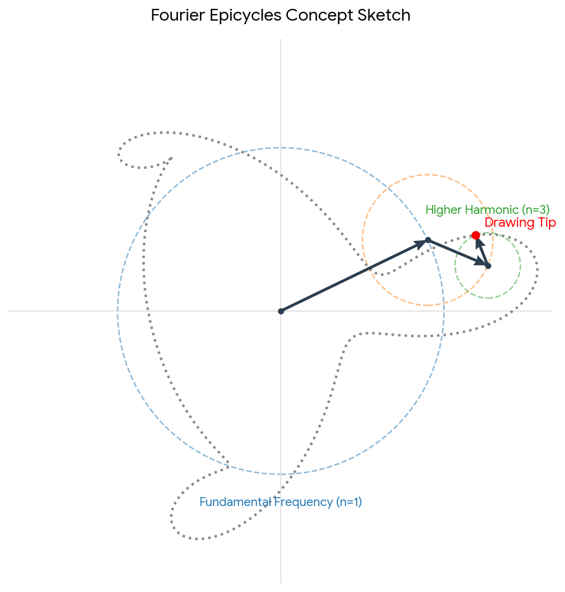
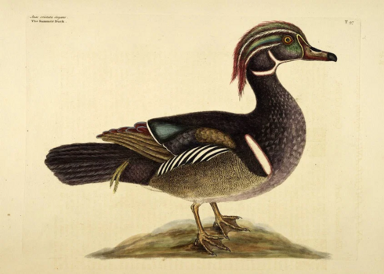
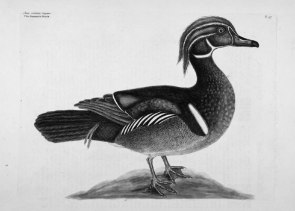
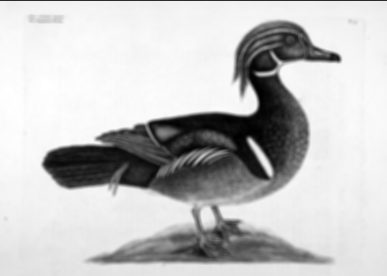
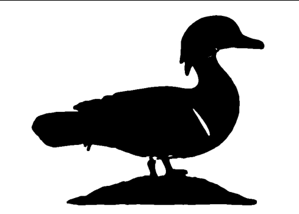
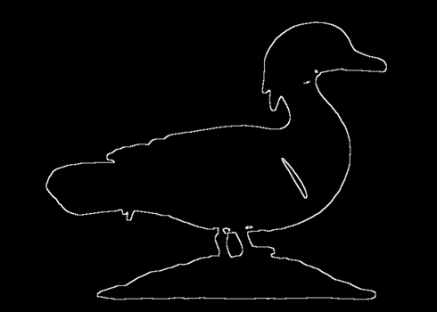
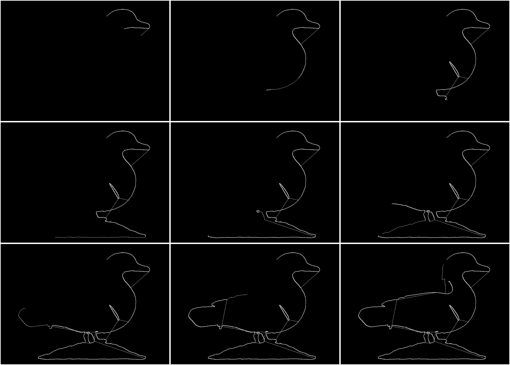
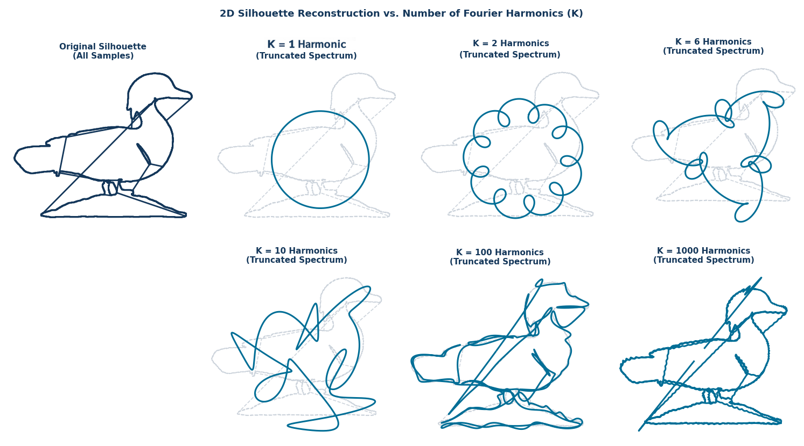

# CS6524: Computer Vision — Lab 1: Silhouettes and Fourier Epicycles

**Immersive Software Engineering (ISE) — University of Limerick**  

**Instructor:** Juan Albarracín [✉️](mailto:Juan.Albarracin@ul.ie)\
**Teacher Assistant:** Thendral Balakrishnan [✉️](mailto:balakrishnan.thendral@ul.ie)\
**Module Lead:** James Patten [✉️](mailto:James.Patten@ul.ie)

**Deadline:** Sunday, November 8th at Midnight (Autumn Semester Week 2)

---

## 🎯 Objective

Understand the use of linear filters on images given a specific objective, and learn the mathematical nature of the Fourier transform.

---

## 📌 Context

An **epicycle** is a geometric model from ancient and medieval astronomy in which a planet moves along a small circle (the epicycle) whose center travels along a larger circle (the deferent) centered on or near the Earth. Used primarily to describe planetary orbits prior to Kepler's laws of planetary motion, epicycles nowadays serve as an intuitive visualization of the Fourier decomposition of complex 2D signals.


*Figure 1: Fourier Epicycles Concept Sketch showing fundamental frequency ($n=1$) and higher harmonics ($n=3$) tracing a complex path.*

### How Epicycles Work

In this model, stacked vectors rotate independently around their respective origins:

* **Radius:** Represents the amplitude ($\vert{}C_k\vert{}$) of a harmonic.
* **Rotational Speed & Direction:** Represents its frequency ($\omega_k$).
* **Initial Vector Orientation:** Represents its phase ($\theta_k$).
* **Tip-to-Tail Stacking:** Represents vector addition, i.e., the summation of complex harmonics.

According to Fourier theory, any periodic signal can be represented as an infinite sum of harmonics. By extending this concept to a continuous 2D perimeter $z(t) = x(t) + iy(t)$, a specific configuration of rotating epicycles can reproduce [any arbitrary closed silhouette in 2D space](https://www.dynamicmath.xyz/fourier-epicycles/sketches/t-rex/).

In this laboratory, you will implement an algorithm that draws an object's silhouette using rotating epicycles. Your input will **not** be a pre-extracted set of boundary coordinates, but a raw natural image. You must first transform this image by applying sequential linear spatial filters (e.g., Gaussian smoothing and spatial derivative filters) to detect and extract the object's boundary before computing its Fourier descriptors.

---

## 🔄 Pre-processing Pipeline

> **Note:** The pipeline described below is just an example. The same sequence of operations may not work for every image you choose.

| Step | Visual Output | Description |
| :--- | :---: | :--- |
| **i) Raw Image** |  | Start with a standard color image. |
| **ii) Grayscale** |  | Transform the image into grayscale for convenience. |
| **iii) Blurring** |  | Apply Gaussian blur/smoothing to remove artifacts (e.g., top-left text). |
| **iv) Thresholding** |  | Apply a fixed threshold to segment the silhouette. |
| **v) Border Detection** |  | Apply derivative/border detection filters to extract object edges. |

> **Tip:** Don't worry if the silhouette is not a perfect closed shape—attaining absolute perfection is out of scope. Just ensure that the borders are thin and have as few gaps as possible.

---

## 📐 Silhouette Trajectory

Once you have identified the edge pixels corresponding to the silhouette, transform them into a 2D parametric curve $(x(t), y(t))$, where $x(t)$ is as close as possible to $x(t+1)$.


*Figure 2: Ordered progression of tracing the object's boundary pixel trajectory.*

You can use the following reference Python snippet to sort and resample your silhouette points:

```python
import numpy as np

# Inputs
#   edge_x: list of x-coordinates of all the pixels in the silhouette
#   edge_y: list of y-coordinates of all the pixels in the silhouette

# Unsorted pixel coordinates of the silhouette
points = np.column_stack((edge_x, edge_y))
ordered_pts = [points[0]]
unvisited = list(points[1:])

while unvisited:
    last_pt = ordered_pts[-1]
    # Calculate Euclidean distances to remaining unvisited edge pixels
    dists = np.sum((unvisited - last_pt) ** 2, axis=1)
    nearest_idx = np.argmin(dists)
    ordered_pts.append(unvisited.pop(nearest_idx))

ordered_pts = np.array(ordered_pts)

# Resampling to fixed number of uniform samples
num_samples = 500
distances = np.sqrt(np.sum(np.diff(ordered_pts, axis=0) ** 2, axis=1))
cumulative_dist = np.insert(np.cumsum(distances), 0, 0)
total_length = cumulative_dist[-1]

target_dists = np.linspace(0, total_length, num_samples, endpoint=False)
x_resampled = np.interp(target_dists, cumulative_dist, ordered_pts[:, 0])
y_resampled = np.interp(target_dists, cumulative_dist, ordered_pts[:, 1])
```

> **Note:** You may notice straight lines cutting across the object where the nearest-neighbor algorithm connects distant points. You are encouraged to refine this logic to achieve a smoother trajectory.

---

## 🌊 Fourier Epicycles

1. Represent the 2D trajectory as a 1D complex signal:

$$z[n] = x[n] + i \cdot y[n]$$

2. Compute the 1D Discrete Fourier Transform (DFT) $Z[u]$ using `numpy.fft` to extract amplitudes, phases, and frequencies of the harmonics.

3. Select the top $K$ harmonics and reconstruct the trajectory using the Inverse Fourier Transform:

$$z'[n] = \frac{1}{N} \sum_{u=0}^{K-1} F[u] \exp(2\pi i \, \omega[u] \, n)$$

where:
* $K$ is the number of selected harmonics.
* $F[u]$ contains the harmonic amplitudes/phases.
* $\omega[u]$ represents the corresponding frequencies.

Below you can see different reconstructions according to the number of harmonics:


*Figure 3: Reconstruction of silhouette with increasing number of Fourier Harmonics ($K = 1, 2, 5, 10, 100, 1000$).*

> As $K$ increases, the reconstruction quality improves and closely matches the original silhouette.

---

## 🎁 Bonus (+1.0 Grade Point)

Include an **MP4 animation** of the rendering process showing the rotating epicycles drawing the shape. Any animation library (e.g., `matplotlib.animation`, `ffmpeg`) is permitted for rendering the video.

---

## 📋 Submission Guidelines and Rules

### 1. Repository Setup and Student Identification
- **Forking Requirement:** You must fork the official starter repository into your own GitHub account or team space.
- **Repository Naming Convention:** Rename your forked repository to: `cs6524-lab1-group<XX>`
- **Identification (`TEAM.md`):** Add a `TEAM.md` file in the repository root with the full names, student IDs, and GitHub usernames of all team members before making your final push.

### 2. Code Structure and Execution
- **Main Entry Point:** All execution must be triggered by running `python main.py` in the repository root without any command-line arguments.
- **Custom Modules:** Any additional helper scripts or custom functions must be placed inside the `mypylibs/` directory.
- **Allowed and Prohibited Libraries:**
    - **Allowed:** `PIL` (Pillow) for reading/saving image files, `matplotlib` for generating and saving mosaic figures, `scipy` (`scipy.ndimage` / `scipy.signal`) for convolution operations, and `numpy`.
    - **General Policy:** Any standard library pre-installed in the provided base Docker container is acceptable as long as `python main.py` runs cleanly.
    - **Strictly Prohibited:** OpenCV (`cv2`) and `scikit-image` are forbidden. You must design and build your own spatial filter kernels explicitly in Python.

### 3. Input Specifications (`in/`)
Provide at least 5 distinct test images (if you include the duck one from this description, then at least 6 images) in the `in/` directory:
- **Naming Convention:** `00.png`, `01.png`, `02.png`, etc. (strictly two digits + `.png`).
- **Optional Configuration:** If an image requires custom tuning parameters or thresholds, place a matching configuration file in `in/` (e.g., `00.yaml`).
- **Image Selection and Resolution Limits:**
    - Select real-world subjects with clear foreground objects and moderate surface texture. Avoid overly simple cartoon graphics as well as excessively cluttered scenes.
    - **Resolution Limit:** Keep image dimensions small to moderate (e.g., $\le 600 \times 600\text{ px}$). Do not use HD images, as large boundary lengths will severely lag contour tracing and Fourier computations.

### 4. Output Specifications (`out/`)
For each input image `XX.png`, your script must programmatically save exactly three mosaic figures to the `out/` directory:
1. `XX_transforms.png`: A multi-panel mosaic displaying the sequential intermediate spatial filter transformations applied to the image leading up to the extracted boundary mask. Each subplot must feature an informative title describing the applied operation.
2. `XX_trajectory.png`: A grid of 10 sequential frames illustrating the temporal tracing of the resampled 2D boundary points over time. After uniform arc-length resampling, the 10 subplots must show the step-by-step progression of the boundary path from start ($t=0$) to closed contour ($t=T$).
3. `XX_final.png`: A mosaic of 20 subplots displaying the Fourier silhouette reconstruction approximated using 5% to 100% of the dominant harmonicsv (in steps of 5%). Plot only the reconstructed 2D silhouette line—you do not need to render the rotating epicycle circles.
4. `XX.mp4`: If opting for the bonus challenge, the video must contain an animated version of `XX_final.png` with the spinning epicycles.

### 5. Written Report and Assets (`report.tex` and `assets/latex/`)
- *File Location and Template:* Write your report in `report.tex` in the repository root, using the provided IEEE Transactions LaTeX template.
- **Report Assets (`assets/latex/`):** Place all figures, sub-diagrams, and external files needed for your LaTeX report inside the `assets/latex/` directory to keep the root directory tidy.
- **Length Limit:** Maximum 3 pages (including figures and references).
- **Required Content:**
    - **Methodology:** Concise description of your image processing pipeline and 1D complex Fourier descriptor formulation.
    - **Justifications:** Technical reasoning behind your spatial filter designs, kernel selections, and thresholding choices.
    - **Discussion and Failure Analysis:** Critical analysis of where the pipeline succeeded or failed, along with concrete steps for improvement if given more time.
- **Writing Quality and Authenticity:** Be brief, rigorous, and specific. Your analysis must convince the reader that you personally conducted the experiments, understood the mathematical trade-offs, and derived the insights yourself. Avoid pasting generic, boilerplate text from LLMs—reports that read like unverified AI summaries will be flagged and incur heavy grade deductions.

### 6. CI/CD Pipeline, Local Testing and Bonus Point
- **Automated Workflow:** GitHub Actions will execute `main.py` and compile `report.tex` into `report.pdf` upon pushing to `main`.
- **Local Docker Testing:** It is strongly recommended to test your code locally using the provided Docker environment before pushing to ensure pipeline compatibility.
- **Workflow Modifications and Bonus Point (+1):**
    - **Default Rule:** Modifying `.github/workflows/pipeline.yml` is not permitted.
    - **Bonus Challenge (+1 Point):** If your solution requires additional Python dependencies not included in the base Docker image, you may claim the bonus point by adding a `requirements.txt` file and updating `.github/workflows/pipeline.yml` to install them prior to running main.py.
    - **⚠️ Resource Disclaimer for Bonus Seekers:** Any extra dependencies or heavy computations added for the bonus point are strictly at your own risk. The CI runner environment has limited CPU, memory, and timeout thresholds. If your extra computation exhausts server resources or causes the job to time out, your submission will fail. Make sure your code runs as efficiently and smoothly as possible!